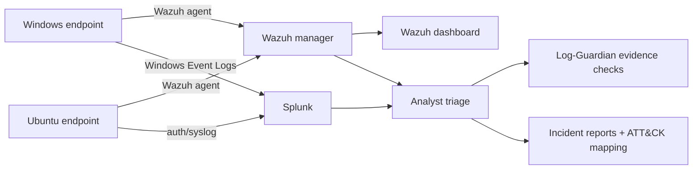

# SOC-Lab — Security Operations Centre Home Lab

A defensive, portfolio-ready SOC Analyst L1 lab that combines Wazuh endpoint monitoring, Windows event investigation, Splunk detections, MITRE ATT&CK mapping, and incident response documentation. It complements the Log-Guardian forensic engine in this repository.

> **Safety and scope:** This lab is for systems you own or are explicitly authorised to monitor. All attack scenarios in this repository are simulated. Do not run tests against third-party systems. No real credentials, personal data, or production logs belong in this repo.

## Outcomes

By completing the lab, you should be able to:
1. Onboard Ubuntu and Windows endpoints to Wazuh and validate agent telemetry.
2. Enable Windows audit categories and investigate authentication, process, account, and group-change events.
3. Search Windows and Linux security events in Splunk using SPL, build detections, and explain alert logic.
4. Map observable behaviours to MITRE ATT&CK techniques without treating a technique match as proof of compromise.
5. Write structured incident reports with evidence, confidence, impact, containment, recovery, and lessons learned.

## Architecture

Wazuh and Splunk are separate collection paths in this starter lab. Configure each endpoint to send the relevant data to the platform you have installed. Do not assume an event visible in one platform is automatically indexed in the other.

## Suggested lab topology

| Component | Suggested lab address | Purpose |
|---|---|---|
| Wazuh server | 192.168.56.10 | Manager, indexer, dashboard |
| Windows 10/11 VM | 192.168.56.20 | Security and PowerShell events |
| Ubuntu VM | 192.168.56.30 | auth/syslog and Linux endpoint telemetry |
| Splunk Enterprise / Free | 192.168.56.40 | Search, detections, dashboards |

Use a host-only or isolated NAT network. Replace example IPs with your own. Avoid exposing SIEM management ports to the public internet.

## 1. Wazuh SOC home lab

### Deploy the Wazuh server

For a beginner lab, use the official Wazuh installation assistant or the official all-in-one virtual appliance. Follow the current official documentation because supported OS versions, package versions, and resource requirements change:

- Wazuh quickstart: https://documentation.wazuh.com/current/quickstart.html
- Wazuh virtual machine: https://documentation.wazuh.com/current/deployment-options/virtual-machine/index.html
- Wazuh agent deployment: https://documentation.wazuh.com/current/installation-guide/wazuh-agent/index.html

Suggested starting resources for an all-in-one VM: 4 vCPU, 8 GB RAM, and 50 GB disk (increase for larger event volumes). Keep it on the isolated lab network.

### Enrol Ubuntu and Windows agents

1. In the Wazuh dashboard, open **Agents → Deploy new agent**.
2. Select the endpoint OS and enter the manager address.
3. Copy the generated installation/enrolment command from the dashboard; it contains environment-specific values.
4. Install and start the agent on each VM.
5. Confirm both agents show **Active** before generating test events.

Use the Wazuh agent configuration snippet in [wazuh/agent-ossec.conf](wazuh/agent-ossec.conf) as a reference for collecting Windows event channels and Linux authentication logs. Merge relevant sections into the agent's existing configuration; do not replace the entire configuration blindly.

### Validate telemetry

- Windows: generate a few failed logons on a disposable local lab account and confirm Security event 4625 is visible.
- Ubuntu: perform a failed SSH login against your own VM and confirm the authentication log is collected.
- Record timestamp, agent name, event source, rule ID, and alert description in your lab notebook.

## 2. Windows Event investigation

Run PowerShell as Administrator inside your Windows lab VM.

1. Read [windows/Enable-SOC-Auditing.ps1](windows/Enable-SOC-Auditing.ps1), then run it to enable the audit subcategories used by this lab.
2. Optionally enable process command-line capture using the documented local policy setting. Command lines may contain secrets; keep the VM isolated and sanitise exports.
3. Run [windows/Export-SecurityEvents.ps1](windows/Export-SecurityEvents.ps1) to export a bounded time window to CSV and JSON.
4. Investigate these event IDs:

| Event ID | Meaning |
|---|---|
| 4624 / 4625 | Successful / failed logon |
| 4634 / 4647 | Logoff |
| 4672 | Special privileges assigned to a new logon |
| 4688 | Process creation (if auditing enabled) |
| 4720 | User account created |
| 4722 / 4725 | User enabled / disabled |
| 4728 / 4732 | Member added to global / local security-enabled group |
| 4740 | Account locked out |
| 1102 | Security audit log cleared |

Event IDs are clues, not verdicts. Correlate account, host, logon type, source address, time, process, and surrounding events.

## 3. Splunk SIEM project

Install Splunk Enterprise or use an eligible Splunk learning/free option. Add a Windows Event Log input (or import sanitised exported CSV/JSON events) and set a consistent index and sourcetype. The queries in [splunk/queries.spl](splunk/queries.spl) are templates: field names vary by input method and add-on.

Start with:
- Failed logons by account and source IP.
- Burst of failed logons followed by a successful logon.
- New local account creation.
- Privileged group membership changes.
- PowerShell script-block activity (4104, if enabled).

Save useful searches as alerts and build a dashboard with panels for failed logons, top source hosts, new accounts, privileged group changes, and PowerShell activity. Configure a sensible time range and threshold; test each alert with synthetic data before enabling notifications.

## 4. MITRE ATT&CK mapping

Use [mitre/attack-mapping.csv](mitre/attack-mapping.csv) and [mitre/detection-coverage.md](mitre/detection-coverage.md). Validate technique names and IDs against the official knowledge base before publishing: https://attack.mitre.org/

Map only the behaviour supported by evidence. A failed-login burst may be consistent with T1110 (Brute Force), but it does not prove an attacker succeeded.

## 5. SOC incident reports

Five clearly labelled simulated case studies are in [reports/](reports/):
- IR-001 — password guessing / brute-force pattern
- IR-002 — suspected phishing execution
- IR-003 — suspected malware execution
- IR-004 — anomalous successful login
- IR-005 — privilege escalation / privileged group change

Each report includes triage, evidence, ATT&CK mapping, severity rationale, containment, recovery, and follow-up. Replace simulated evidence with redacted lab evidence when you complete the exercises. Never claim a real incident occurred when it did not.

## 6. Suggested practical assessment

| Exercise | Evidence to capture | Completion test |
|---|---|---|
| Wazuh onboarding | Agent list screenshot (hide keys/hostnames if needed) | Both agents Active |
| Failed logon triage | Event 4625 and surrounding events | Explain account, source, time, logon type |
| PowerShell triage | Event 4104 or process telemetry | Explain command intent and parent process |
| Splunk brute-force alert | SPL + alert screenshot | Triggered only at chosen threshold |
| ATT&CK mapping | CSV row + rationale | Technique supported by observable behaviour |
| Incident report | One completed report | Evidence, confidence, actions, and closure documented |

## Repository structure

- `windows/` — safe audit-policy enablement and bounded event export scripts.
- `wazuh/` — agent collection configuration reference.
- `splunk/` — SPL detection templates and saved-search examples.
- `mitre/` — technique mapping and coverage notes.
- `reports/` — five simulated incident reports.
- `samples/` — synthetic event generator for safe practice.

## Important operational notes

- Use least privilege and isolated VMs. Revert snapshots after exercises.
- Do not disable endpoint protection or run real malware. The malware case is a paper exercise based on synthetic telemetry.
- Treat alerts as leads. Validate data quality, time synchronisation, asset criticality, user context, and false-positive explanations.
- Preserve original evidence, calculate hashes for exported evidence, record who handled it, and work from copies.
- Do not upload raw Windows event exports, usernames, IPs, tokens, or other sensitive data to a public repository.

## Completion checklist

- [ ] Wazuh server deployed and secured on isolated network
- [ ] Ubuntu agent Active
- [ ] Windows agent Active
- [ ] Windows audit policy enabled and verified
- [ ] Event export script run and output sanitised
- [ ] Splunk data input configured
- [ ] Five SPL searches validated against lab data
- [ ] At least three Splunk alerts tested
- [ ] ATT&CK mappings reviewed against official site
- [ ] Five reports updated with your own lab evidence
- [ ] Screenshots and a short demo recorded with secrets redacted
